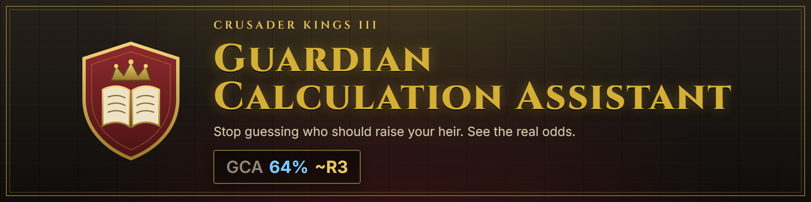

# Guardian Calculation Assistant (GCA)



An interface mod for **Crusader Kings III** that helps you pick a guardian for a child. Every candidate in the list gets a score with the real chance of education progress, computed with the same formula the game uses.

Inspired by the Marriage Calculation Assistant (MCA), which does the same for marriages.

## Features

### GCA score on every candidate

In the **Educate Child**, **Offer Guardianship** and **Offer Ward** lists, each row shows:

```
GCA 64% ~R3
```

- **64%**: the chance that the child gains +2 education points on each birthday (ages 6 to 15) with this guardian.
- **~R3**: the projected education rank at coming of age (shown once the child has an education focus).

Hover it for the breakdown:

- progress and no-progress weights, factor by factor;
- point projection: current points + birthdays left x 2 x chance;
- notes that apply to the pair: Beacon of Learning, Pedagogy, commander trait transfer, Knighthood, different faith or culture.

The score works both ways. With the child picked, it rates guardians. With the guardian picked, it rates children.

### Find guardians outside your court

Vanilla only lets you pick guardians from your own court, or from one specific ruler's court. GCA adds a **Find Guardian (GCA)** interaction to every child at your court without a guardian. It lists:

- you and your courtiers;
- every ruler in your diplomatic range and their courtiers.

Pick a candidate and click **Continue**, and the mod opens the right vanilla interaction already filled in:

- **Educate Child** if the guardian is at your court;
- **Offer Ward** to the guardian's ruler otherwise.

Costs, validity and acceptance stay vanilla.

### Sort by score

The GCA search opens sorted by the highest score. Below the native sort dropdown (still available) there are two buttons:

- **GCA: by score**: sorts by GCA chance, highest first;
- **Default list**: returns to the game's order.

Sorting resets if the list changes, if the game day advances with the window open, or if the native filter panel is open. Click "GCA: by score" again to re-sort.

### Intellect filter

**Quick / Intelligent / Genius** checkboxes above the list show only characters with the ticked traits (nothing ticked shows everyone). It works for guardians and wards. The native **Traits** filter is also added to the filter panel.

## How the score is calculated

GCA reproduces `education_point_acquisition_support_effect` (`common/scripted_effects/00_education_effects.txt`, CK3 1.19). On every birthday from age 6 to 15 the game rolls between:

| Progress (+2 points in the focus) | Weight |
|---|---|
| Base | 60 |
| Child's intellect: Genius / Intelligent / Quick or Shrewd | +20 / +15 / +10 |
| Childhood trait matching / opposing the focus | +20 / -20 |
| Guardian's intellect: Genius / Intelligent / Quick or Shrewd | +15 / +10 / +5 |
| Guardian's skill in the focus | x 0.4 |
| Guardian's learning | x 0.2 |
| Guardian's house aspiration (improved educator outcome) | +5 |

| No progress | Weight |
|---|---|
| Base | 40 |
| Child: Imbecile or Inbred / Stupid / Slow or Dull | +20 / +15 / +10 |
| Guardian: Imbecile / Stupid / Slow or Dull | +15 / +10 / +5 |

**Chance = progress / (progress + no progress).**

Vanilla details kept as they are:

- **Cultures with "better ward education"** (Storytellers and similar): because of how the vanilla script is written, these cultures *replace* the guardian's intellect and skill bonus with a flat +10 instead of adding to it. GCA reproduces this and flags it in the tooltip.
- **Child without a focus yet**: GCA assumes the guardian's best skill.
- **Projected rank**: uses the vanilla cut-offs `education_level_1/2/3` (7/12/17 points). `~R4` means rank 4 or 5 (rank 5 depends on dynasty or estate bonuses).
- **Beacon of Learning** on the guardian's culture adds `round(points / 4)`, up to +3, at coming of age. This is included in the projection.

The projection then adds the average of the coming-of-age bonuses that already apply, in the vanilla order: studying at a university (+2.4), the dynasty's second Kin legacy (+2.4), Beacon of Learning, the ward's culture (+0.6 diplomacy / -1 martial) and the court tutor at the guardian's court, where the ward lives (about +2.4 to +3 depending on aptitude). Events, the court owner's patronage spouse and Confucian study are not predicted.

The tooltip also shows the chance of reaching each level of the projected trait. The birthday rolls are independent, so the number of successes follows a binomial distribution; the coming-of-age bonuses enter at their average. This matters near a cut-off: an average of 12.7 points looks like rank 3, but rank 3 needs more than 12, which may only happen about half the time.

The multipliers are read from the game's own script values (`educator_skill_modifier_factor`, `matching_childhood_trait_modifier_value`, etc.), so mods that change them are followed automatically.

## Installation

1. Download `guardian_calc_assistant-<version>.zip` from the **Releases** page.
2. Extract it into `Documents/Paradox Interactive/Crusader Kings III/mod/`. You should end up with:

   ```
   mod/
     guardian_calc_assistant.mod
     guardian_calc_assistant/
   ```

3. Enable the mod in the launcher.

Safe to add to existing saves, and safe to remove at any time. The only variables stored in the save are the intellect filter and the sort snapshot, both on your character.

## Compatibility

- **Game version:** 1.19.
- **Overridden vanilla file:** `gui/interaction_confirmation.gui`. Conflicts with other mods that override the same file.
- **Derived types:** the list row inherits whichever `widget_character_list_item` the playset provides, so other mods' changes to that row are kept.
- **Marriage Calculation Assistant:** compatible; the two use different windows.
- **Languages:** English and Brazilian Portuguese. Portuguese shows when the game runs with the community PT-BR translation, which adds the `braz_por` language; everyone else gets English. Want another language? [Request a translation](../../issues/new?template=translation_request.yml) or see [CONTRIBUTING.md](CONTRIBUTING.md#translations).

## Layout

```
common/
  character_interactions/tnt_ga_interactions.txt   "Find Guardian (GCA)" interaction
  script_values/tnt_ga_values.txt                   score formula, projection and notes
  scripted_effects/tnt_ga_sort_effects.txt          sort state cleanup
  scripted_guis/tnt_ga_sort.txt                     score sorting (ported from MCA)
  scripted_guis/tnt_ga_filter.txt                   intellect filter
  scripted_triggers/tnt_ga_triggers.txt             guardian requirements and filter
gui/
  interaction_confirmation.gui                      vanilla + GCA list, buttons and filter (generated)
  tnt_ga_character_list_item.gui                    list row with the score (generated)
localization/
  english/  braz_por/
tools/                                              GUI and rank-odds generators, packager, Nexus Mods helper, image renderer
docs/                                               Nexus Mods page text (BBCode) and images (docs/images/src: HTML sources)
.github/workflows/release.yml                       zip and Release on every tag
```

## Development

Both GUI files are generated by script, because their expressions are long and repeated. Do not edit them by hand: change the generator and run it again.

```sh
# 1. List row (also writes tools/gates.txt, used in step 2)
python tools/gen_rows.py tools/row_template.gui gui/tnt_ga_character_list_item.gui tools/gates.txt

# 2. Interaction window, from the vanilla file
python tools/gen_confirm.py tools/gates.txt "<CK3>/game/gui/interaction_confirmation.gui" gui/interaction_confirmation.gui
```

When the game updates, run step 2 against the new vanilla `interaction_confirmation.gui` to keep Paradox's changes.

### Releasing a version

1. Bump `version` in `descriptor.mod`.
2. Add a `## [x.y.z] - YYYY-MM-DD` section to `CHANGELOG.md`, one `- ` line per change. It becomes the GitHub Release notes and the Nexus Mods changelog; the tag build fails without it.
3. Commit, tag and push:

   ```sh
   git tag v1.0.1
   git push origin main v1.0.1
   ```

The `.github/workflows/release.yml` workflow builds the zip with `tools/package.py`, checks that the tag matches the `descriptor.mod` version, takes the notes from `CHANGELOG.md` (`tools/changelog.py`) and publishes the Release with the zip attached. On regular pushes and pull requests it only uploads the zip as a run artifact.

### Nexus Mods

On tags, the workflow also publishes to Nexus Mods (API v3):

1. resolves the unique mod id from the page URL number (`tools/nexus_page.py resolve`);
2. uploads the zip, with that version's `CHANGELOG.md` entries as the Nexus changelog, as a new version of the existing main file with the official [Nexus-Mods/upload-action](https://github.com/Nexus-Mods/upload-action), archiving the previous version;
3. replaces the page summary and full description with `docs/nexus_summary.txt` and `docs/nexus_description.bbcode` (`tools/nexus_page.py update`; the edit endpoint is marked Experimental by Nexus).

Running the workflow manually (Actions > Package > Run workflow) repeats steps 1 and 3 only, to sync the page text without a release.

The Nexus steps are skipped until these are set in the repository settings:

| Kind | Name | Value |
|---|---|---|
| Secret | `NEXUSMODS_API_KEY` | API key from https://www.nexusmods.com/settings/api-keys |
| Variable | `NEXUS_GAME_DOMAIN` | game part of the mod page URL, e.g. `crusaderkings3` in `nexusmods.com/crusaderkings3/mods/123` |
| Variable | `NEXUS_GAME_MOD_ID` | number at the end of the mod page URL, e.g. `123` |
| Variable | `NEXUS_FILE_ID` | file ID of the main file (Files tab > Advanced) |

The mod page and its first file have to be created by hand on Nexus Mods; the action can only add versions to an existing file.

To build the zip locally: `python tools/package.py` (output in `dist/`).

To test, run the game with `-debug_mode` and check `Documents/Paradox Interactive/Crusader Kings III/logs/error.log`. The warning `Event target 'tnt_ga_other' is used but is never set` is expected: that scope is filled in by the GUI.

## License

[MIT](LICENSE), covering the mod's own code and text. `gui/interaction_confirmation.gui` is generated from the vanilla Crusader Kings III file, and the vanilla content in it remains the property of Paradox Interactive. Crusader Kings III is a trademark of Paradox Interactive AB.
